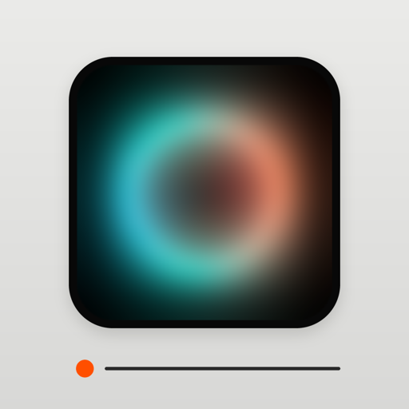

<p align="center">
  
</p>

<h1 align="center">LB-64 for Home Assistant</h1>

<p align="center">
  Control an LB-64 light block from Home Assistant, over your own network.<br>
  No cloud, no MQTT, no add-on: this one integration is all there is to install.
</p>

---

## What is the LB-64?

A square ambient lamp: a 64x64 LED panel behind a white shade that shows slow, organic
animations (aura, orb, lava, sunset, fire, aurora, your own drawing …), with a wake-up light
and an evening wind-down. It is set up with its iOS app over Bluetooth; once it is on your
WiFi it also talks to Home Assistant directly.

## What you get

| Entity | |
|---|---|
| **Light** | On/off with the lamp's own fades, brightness, and the lamp's **presets as effects**, by name. The list follows the lamp: a preset you make, rename or delete in the app is there at once |
| **Light colour** | Picking a colour gives one plain colour: it recolours the lamp's `solid` preset (and switches to it if something else is showing). Animated presets are never changed; for those the colour shown is the first of their palette |
| **Speed** | 0–200, of the preset that is showing (the lamp remembers it per preset) |
| **Boost** | 0–100 %, pushes the light past full colour: brighter, paler |
| **Wake-up light**, **Wake-up time** | A sunrise that is complete at the wake-up time. Turning the light on or off while it runs dismisses it |
| **Wind-down**, **Wind-down time** | The lamp dims and warms, and is off at the wind-down time |
| **Schedule** | The weekly on/off schedule made in the app |
| **Mode** | Off, on, preview, sunrise, wind-down |
| **Diagnostics** | Estimated current and power, load, frame rate, WiFi signal, free memory (disabled by default), and a restart button |

Everything is **pushed**: a change made in the app, with the buttons on the lamp or by its
schedule shows in Home Assistant within a fraction of a second, and nothing is polled. If the
lamp restarts or drops off WiFi its entities become unavailable and come back by themselves;
if its address changes, Home Assistant follows it.

Start a preset from an automation by its name:

```yaml
action: light.turn_on
target:
  entity_id: light.lb_64_7684
data:
  effect: sunset
  brightness_pct: 60
```

## Installation

The integration is installed from this GitHub repository:
`https://github.com/MaxGramser/lb64-homeassistant`

### Home Assistant 2026.11 or newer: the Marketplace

Home Assistant has the community store built in (it used to be HACS).

[](https://my.home-assistant.io/redirect/hacs_repository/?owner=MaxGramser&repository=lb64-homeassistant&category=integration)

Press the button, or do it by hand:

1. Go to **Settings → Marketplace**.
2. Select **Add from link** in the upper-right corner.
3. Under **GitHub link**, enter `https://github.com/MaxGramser/lb64-homeassistant` and select **Add**.
   If it asks for a **Type**, choose **Integration**. (The first time, the Marketplace asks you
   to connect your GitHub account.)
4. Open **LB-64** and install it. If Home Assistant shows a repair that asks for a restart,
   let it restart.

Updates then arrive in Home Assistant like any other update.

### Home Assistant 2026.10 or older: HACS

1. Open **HACS**, then the three dots in the upper-right corner → **Custom repositories**.
2. Enter `https://github.com/MaxGramser/lb64-homeassistant`, type **Integration**, and select **Add**.
3. Find **LB-64** in HACS, select **Download**, and restart Home Assistant.

### By hand

1. Download this repository: the green **Code** button on GitHub → **Download ZIP**, or the
   source of the [latest release](https://github.com/MaxGramser/lb64-homeassistant/releases/latest).
2. Copy the folder `custom_components/lb64` into the `custom_components` folder of your Home
   Assistant configuration (create that folder if it is not there), so that you get
   `config/custom_components/lb64/manifest.json`.
3. Restart Home Assistant.

Installed by hand, the integration does not update itself: repeat these steps for a new version.

## Setup

1. Put the lamp on your WiFi: in the LB-64 app, **setup → wifi** (2.4 GHz networks).
2. In Home Assistant, **Settings → Devices & services** shows **LB-64 found**. Press **Add**.

Not found? **Add integration → LB-64** and enter the lamp's address (`lb64-xxxx.local` or its
IP address; the app shows both under wifi).

## Requirements

- An LB-64 with firmware **0.2.0** or later, on the same network as Home Assistant
- Home Assistant 2026.2 or later

## How it works

The lamp serves a small API on port 80 and announces itself over mDNS as `_lb64._tcp`:

| | |
|---|---|
| `GET /api/state` | everything about the lamp as JSON |
| `GET /api/events` | the same as a stream (Server-Sent Events): `state` on every change, `stats` every 5 seconds |
| `POST /api/command` | the lamp's text commands, one per line (`POWER:1`, `BRIGHTNESS:40`, `PRESET:USE:3`, `COLOR:FF8800` …) |

The integration keeps one stream open per lamp and sends commands as they are needed. The API
has no password: it is meant for your home network, like most lamps of this kind. It can be
switched off in the app (setup → wifi → home assistant).

## Troubleshooting

**The lamp is not found.** It must be on WiFi (the app shows "connected" and an address) and on
the same network as Home Assistant; guest networks and client isolation block discovery. Add it
by address instead.

**Entities are unavailable.** Home Assistant cannot reach the lamp. Check that it has power and
that `http://lb64-xxxx.local/api/state` opens in a browser. It reconnects by itself.

**Commands feel slow.** WiFi signal: see the *WiFi signal* sensor (below −75 dBm is weak).

## Development

```bash
pip install -r requirements_test.txt
pytest
```

The tests run the integration against a fake lamp on a local socket (`tests/conftest.py`).
